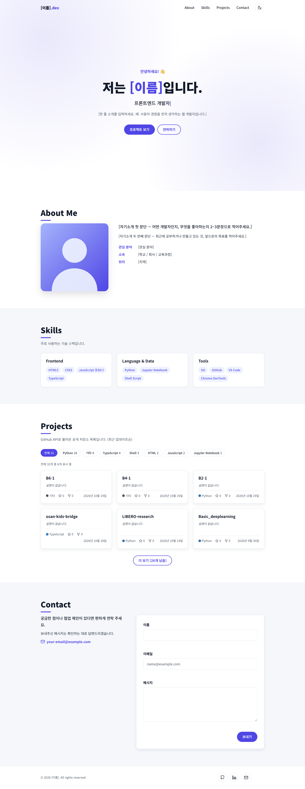
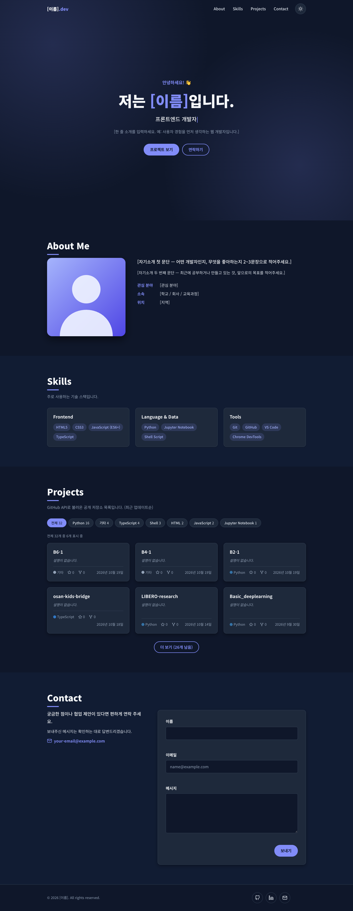
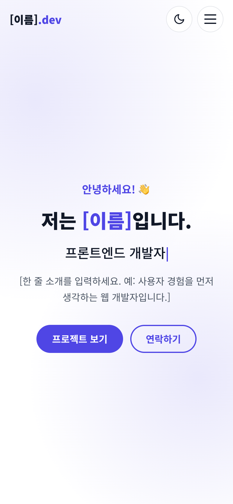
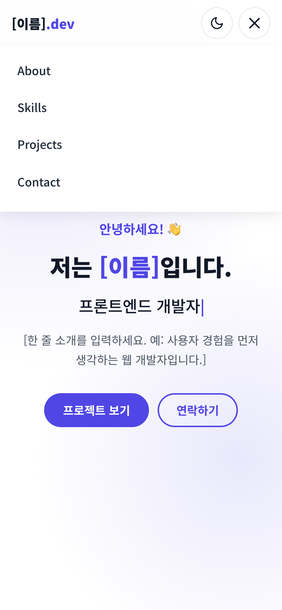
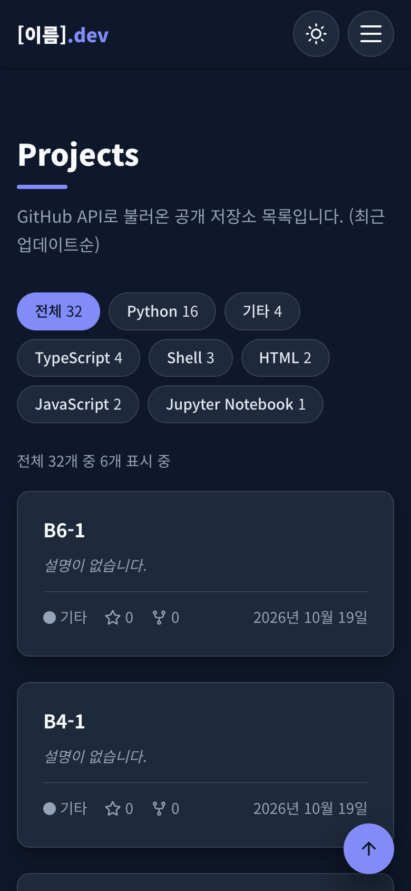
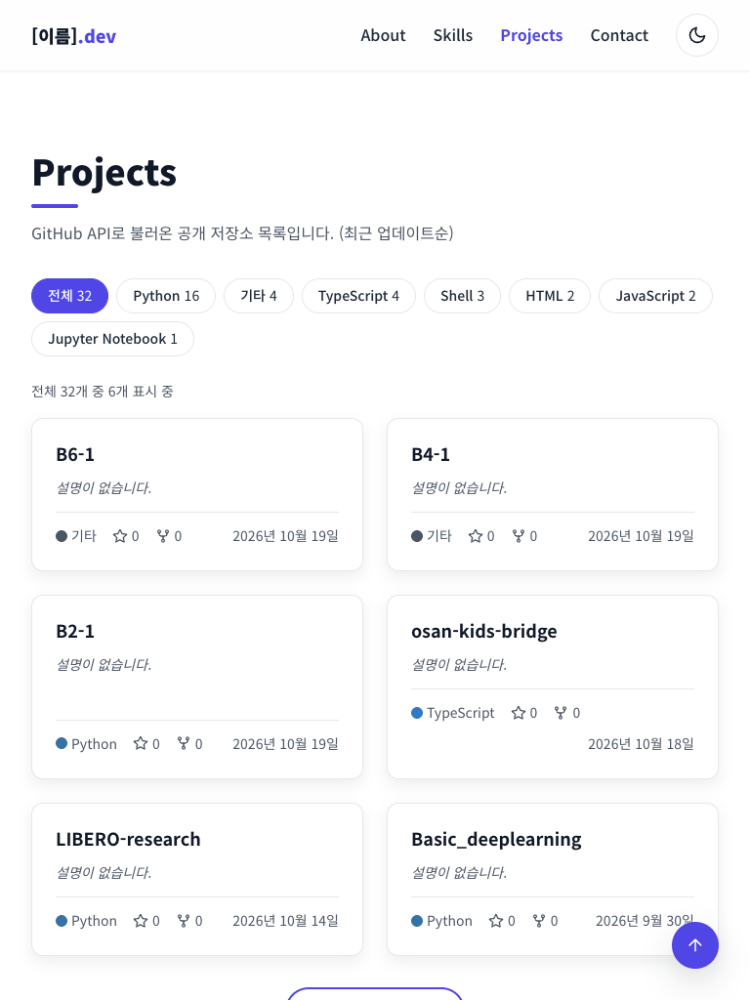
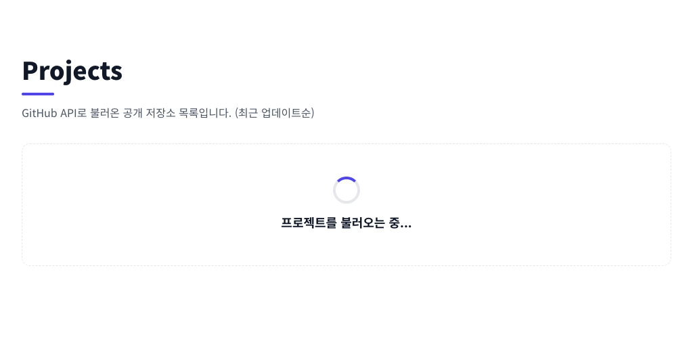
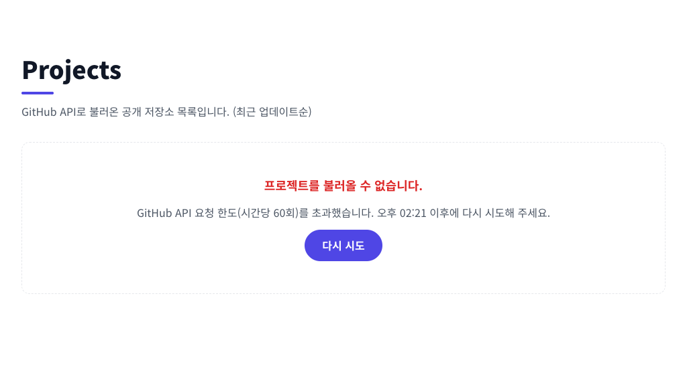
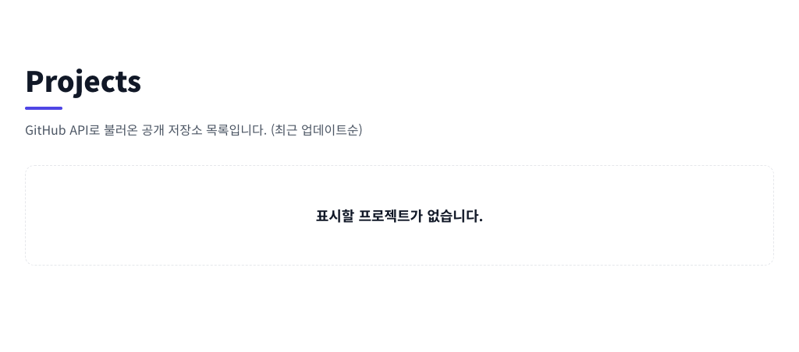
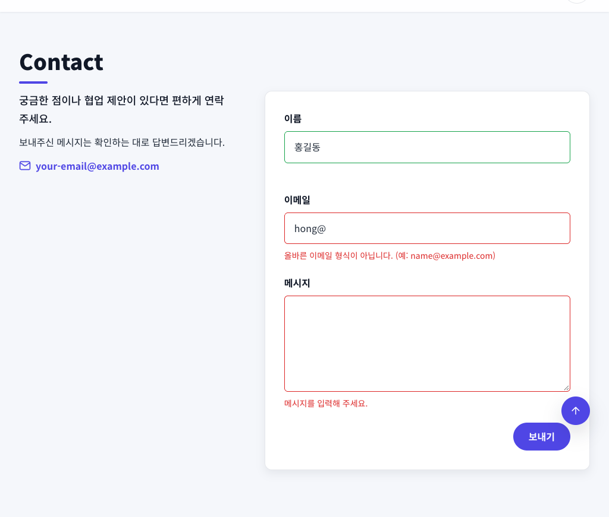

# [이름]의 포트폴리오

> 외부 라이브러리 없이 **순수 HTML / CSS / JavaScript**만으로 만든 반응형 포트폴리오 웹사이트입니다.
> GitHub API로 공개 저장소를 불러와 Projects 섹션에 보여주고, 다크 모드·햄버거 메뉴·스크롤 애니메이션·폼 유효성 검사 같은 인터랙션을 직접 구현했습니다.

- **배포 URL**: https://nicetry3675.github.io/B4-1/
- **저장소**: https://github.com/NiceTry3675/B4-1
- **요구사항 충족 설명 문서**: [docs/requirements-guide.md](docs/requirements-guide.md)

<!-- TODO(개인정보): 제목의 [이름]을 바꾸세요. 개인정보를 채운 뒤 스크린샷을 다시 찍으면 좋습니다. -->

## 스크린샷

### 데스크톱 (라이트 / 다크)

| 라이트 모드 | 다크 모드 |
| --- | --- |
|  |  |

### 모바일 / 태블릿

| 모바일 (Hero) | 모바일 (햄버거 메뉴 열림) | 모바일 (다크 모드) | 태블릿 (768px) |
| --- | --- | --- | --- |
|  |  |  |  |

### 상태별 UI (GitHub API)

| 로딩 | 에러 (레이트 리밋 403) | 빈 상태 |
| --- | --- | --- |
|  |  |  |

### 폼 유효성 검사



## 주요 기능

| 기능 | 설명 |
| --- | --- |
| 반응형 레이아웃 | 모바일 퍼스트, 브레이크포인트 `768px`(태블릿)·`1024px`(데스크톱) |
| 햄버거 메뉴 | 모바일에서 메뉴를 숨기고 버튼으로 열고 닫음 (Esc·바깥 클릭·링크 클릭·포커스가 헤더 밖으로 나갈 때 닫힘) |
| 부드러운 스크롤 | 메뉴/버튼 클릭 시 해당 섹션으로 부드럽게 이동, 현재 섹션 메뉴 강조 |
| 네비게이션 스타일 변경 | `60px` 이상 스크롤하면 헤더 배경색과 그림자 표시 |
| 스크롤 탑 버튼 | `300px` 이상 스크롤하면 나타나고, 클릭 시 맨 위로 이동 |
| 다크 모드 | 토글 버튼으로 전환, `localStorage`에 저장되어 새로고침 후에도 유지 |
| 스크롤 애니메이션 | Intersection Observer(`threshold: 0.2`)로 요소가 보일 때 나타남 |
| GitHub API 연동 | 저장소 목록을 카드로 렌더링, 로딩·성공·에러·빈 상태 UI, 재시도 버튼 |
| 폼 유효성 검사 | 필수값·이메일 형식·메시지 길이 검사, 입력 필드 아래 에러 메시지, 성공 메시지 |
| **보너스** 언어 필터 | 저장소를 언어별로 필터링 (`array.filter()`) + 더 보기 |
| **보너스** 타이핑 효과 | Hero 문구가 한 글자씩 써졌다 지워짐 |
| **보너스** 시스템 다크 모드 감지 | 저장된 설정이 없으면 `prefers-color-scheme`을 따름 |
| **보너스** 폼 실제 전송 | `js/config.js`에 Formspree ID를 넣으면 실제 전송 (비워두면 데모 모드) |

## 사용 기술

- **HTML5**: 시맨틱 태그(`header`, `nav`, `main`, `section`, `article`, `figure`, `footer`), 접근성 속성(`aria-*`, `label for`)
- **CSS3**: CSS 변수(`:root`, `[data-theme="dark"]`), Flexbox, Grid(`auto-fit` + `minmax`), 미디어 쿼리, `transition`, `@keyframes`
- **JavaScript (ES6+)**: `const`/`let`, 화살표 함수, 템플릿 리터럴, 구조분해 할당, 스프레드, `map`/`filter`/`forEach`/`reduce`, `fetch` + `async`/`await`, `try`/`catch`, Intersection Observer, `localStorage`
- **API**: GitHub REST API — `GET https://api.github.com/users/NiceTry3675/repos`
- **웹 폰트**: Google Fonts (Noto Sans KR)
- **배포**: GitHub Pages
- 아이콘은 라이브러리 없이 인라인 SVG로 그렸습니다. React·jQuery·Bootstrap·Tailwind 등 **외부 라이브러리는 사용하지 않았습니다.**

## 기준값

요구사항에서 "자유롭게 바꿀 수 있으나 README에 명시"하라고 한 값입니다. 스크롤·애니메이션 기준값은 [`js/config.js`](js/config.js) 한곳에서 바꿀 수 있습니다.

| 항목 | 값 | 설정 위치 |
| --- | --- | --- |
| 네비게이션 배경색이 바뀌는 스크롤 위치 | **60px** 이상 | `CONFIG.navScrollThreshold` |
| 스크롤 탑 버튼이 나타나는 스크롤 위치 | **300px** 이상 | `CONFIG.scrollTopThreshold` |
| 스크롤 애니메이션 Intersection Observer `threshold` | **0.2** (요소가 20% 보일 때) | `CONFIG.revealThreshold` |
| 처음 보여줄 프로젝트 카드 수 / 더 보기 단위 | 6개 | `CONFIG.projectsPageSize` |
| 반응형 브레이크포인트 | 768px(태블릿), 1024px(데스크톱) | `css/style.css` 미디어 쿼리 (768px은 `js/nav.js`의 `desktopQuery`에도 사용) |

## 폴더 구조

```text
.
├── index.html              # 메인 페이지 (시맨틱 마크업)
├── css/
│   └── style.css           # 전체 스타일 (CSS 변수, 다크 테마, 반응형)
├── js/
│   ├── config.js           # 설정값 (GitHub 아이디, 기준값, Formspree ID)
│   ├── utils.js            # 공통 도우미 (escapeHTML, prefersReducedMotion)
│   ├── theme.js            # 다크 모드 + localStorage
│   ├── nav.js              # 햄버거 메뉴, 부드러운 스크롤, 현재 섹션 표시
│   ├── scroll.js           # 네비게이션 스타일 변경, 스크롤 탑 버튼
│   ├── reveal.js           # 스크롤 애니메이션 (Intersection Observer)
│   ├── typing.js           # Hero 타이핑 효과
│   ├── projects.js         # GitHub API 연동, 상태별 렌더링, 언어 필터
│   ├── form.js             # 문의 폼 유효성 검사
│   └── main.js             # 진입점: 모든 init 함수 호출
├── images/
│   ├── profile.svg         # 프로필 이미지 (자리표시)
│   ├── favicon.svg
│   └── screenshots/        # README 스크린샷
├── docs/
│   └── requirements-guide.md  # 요구사항별 구현 설명 문서
└── .nojekyll               # GitHub Pages에서 Jekyll 처리를 건너뜀
```

## 실행 방법

### VS Code + Live Server (권장)

1. VS Code에서 이 폴더를 엽니다.
2. 확장 프로그램 **Live Server**(Ritwick Dey)를 설치합니다.
3. `index.html`을 연 뒤 오른쪽 아래 **Go Live**를 누르면 `http://127.0.0.1:5500`에서 열리고, 저장할 때마다 자동으로 새로고침됩니다.

### 터미널에서 실행

```bash
python3 -m http.server 5500
```

브라우저에서 `http://localhost:5500`으로 접속합니다.

## 상태별 UI 직접 확인하기

Chrome 개발자 도구(F12)로 Projects 섹션의 각 상태를 직접 재현할 수 있습니다.

| 상태 | 확인 방법 |
| --- | --- |
| 로딩 | Network 탭 → 속도 제한(Throttling)을 **3G** 같은 느린 프리셋으로 두고 새로고침 |
| 에러 | Network 탭에서 `repos?...` 요청을 우클릭 → **Block request URL** → 새로고침 → 에러 메시지와 **다시 시도** 버튼 확인 → 차단을 해제(Network request blocking 패널)한 뒤 다시 시도. (Offline 모드는 페이지 자체가 열리지 않아 이 방법을 씁니다) |
| 빈 상태 | Network 탭에서 `repos?...` 요청을 우클릭 → **Override content** → 응답 내용을 `[]`로 저장한 뒤 새로고침 (또는 `js/config.js`의 `githubUsername`을 공개 저장소가 없는 계정으로 변경) |
| 레이트 리밋 | 인증 없는 요청은 IP당 **시간당 60회**까지입니다. 초과하면 403 응답이 오고, 에러 UI에 다시 시도할 수 있는 시각이 표시됩니다 |

> 짧은 시간에 새로고침을 반복하면 레이트 리밋에 걸릴 수 있으니 주의하세요.

## 개인정보 채우기

개인정보는 아직 자리표시로 남아 있습니다. `TODO(개인정보)` 주석을 검색하면 고칠 곳을 모두 찾을 수 있습니다.

```bash
grep -rn "TODO(개인정보)" index.html README.md
```

- `index.html`: 페이지 제목·설명, 로고, Hero 이름·타이핑 문구·한 줄 소개, About 자기소개·사실 목록, Skills, 이메일, LinkedIn, 푸터 이름
- `images/`: 프로필 사진을 넣고 `index.html`의 ``와 `alt` 수정
- (선택) `js/config.js`: `formspreeId`에 Formspree 폼 ID를 넣으면 문의 폼이 실제 이메일로 전송됩니다

## 배포 (GitHub Pages)

1. 이 저장소를 GitHub에 push합니다.
2. 저장소 **Settings → Pages**에서 Source를 **Deploy from a branch**, Branch를 **`main` / `/ (root)`**로 설정합니다.
3. 몇 분 뒤 https://nicetry3675.github.io/B4-1/ 에서 확인합니다.
